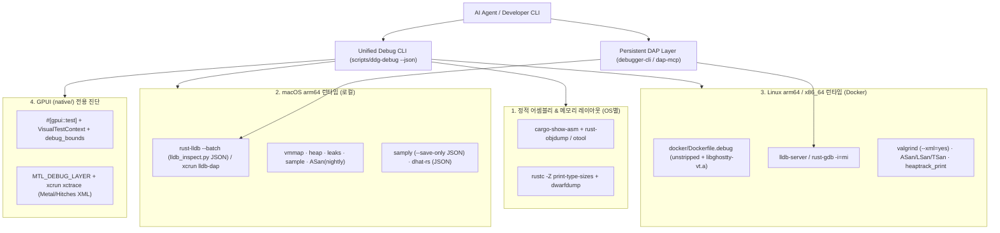

# 에이전트 친화적 Rust · GPUI 멀티 OS 디버깅 환경 설계서

> 상태: 구현·검증 완료 (`T0`–`T4`, 2026-11-26)  
> 대상 워크스페이스: `dotdotgod-agents` (`ddg-agents-proto` · `ddg-agents-vt` · `ddg-terminal-server` · `ddg-agents-host` · `ddg-agents-transport` · `ddg-agents-cli` · `native` GPUI)

## 1. 목표 및 핵심 원칙

로컬 Apple Silicon macOS 개발 환경에서 **메모리 직접 확인**, **OS·아키텍처별 어셈블리 직접 확인**, **C FFI(`libghostty-vt`)·Tokio 검증**, **GPUI(`native/`) UI·Metal 렌더링 진단**을 **100% CLI 기반의 에이전트 친화적(Agent-Friendly) 인터페이스**로 통합한다.

### Agent CLI Contract (필수 설계 원칙)
1. **Zero-GUI / Zero-TUI 의존**: 사람 전용 GUI(Xcode GUI, FireDBG, Tracy GUI)나 전체 화면 TUI(`tokio-console`, `pwndbg` 대시보드)를 기본 경로에서 배제한다.
2. **구조화 출력(`stdout` = 데이터, `stderr` = 로그)**: 모든 진단 래퍼는 `--json`(또는 원본 JSON/XML/CSV) 출력을 지원하며, ANSI 색상 코드를 제거한다.
3. **비대화형 실행 + 선택적 세션 유지**:
   * 단발 조회는 `--batch` + 타임아웃으로 즉시 종료한다.
   * 멀티턴 스텝/메모리/어셈블리 추적은 **DAP(Debug Adapter Protocol)** 데몬(`xcrun lldb-dap` / `lldb-server`)을 통해 상태를 유지한다.
4. **프로덕션 무오염**: 디버그 전용 의존성(`gpui/test-support`, `dhat`, 디버그 심볼 컨테이너)은 `dev-dependencies`, 선택 Feature, 별도 `Dockerfile.debug`로 격리한다.

---

## 2. 전체 아키텍처



---

## 3. 현재 로컬 환경 점검 결과 및 도구 인벤토리

### 3.1 이미 설치되어 즉시 사용 가능한 도구 (로컬 macOS `arm64` 검증 완료)

| 도구 | 경로 / 버전 | 역할 |
| :--- | :--- | :--- |
| `rust-lldb` / `lldb` | `~/.cargo/bin/rust-lldb`, `lldb-2103.0.34.103` | macOS 런타임 메모리·레지스터·어셈블리 직접 검사 |
| **`xcrun lldb-dap`** | `/Applications/Xcode.app/.../usr/bin/lldb-dap` | 에이전트 멀티턴 디버깅용 표준 DAP 어댑터 |
| `objdump` / `otool` / `dwarfdump` | `/usr/bin/*` | Mach-O 디스어셈블리 · DWARF 디버그 정보 · 섹션 분석 |
| `vmmap` / `heap` / `leaks` / `sample` | `/usr/bin/*` | 프로세스 가상메모리 · 힙 객체 · 누수 스택 · CPU 샘플링 |
| **`xcrun xctrace`** | `/usr/bin/xctrace` | CLI 프로파일 녹화 및 XML Export (`Metal System Trace`, `Animation Hitches`, `Allocations`, `Leaks`, `Time Profiler` 템플릿 보유 확인) |
| `docker` | `/usr/local/bin/docker` | Linux `arm64` / `x86_64` 디버그 컨테이너 실행 |

### 3.2 추가 설치 대상 (우선순위별)

| 단계 | 도구 / 컴포넌트 | 설치 명령 | 용도 |
| :--- | :--- | :--- | :--- |
| **P0 (필수)** | `cargo-show-asm` | `cargo install cargo-show-asm` | Rust 소스 인터리빙 어셈블리(`--rust`) · LLVM IR · MIR OS별 출력 |
| **P0 (필수)** | `cargo-nextest` | `cargo install cargo-nextest --locked` | 격리 고속 테스트 + GPUI/워크스페이스 기계 파싱 결과 |
| **P0 (필수)** | `samply` | `cargo install samply` | `--save-only` JSON CPU 프로파일 추출 |
| **P0 (필수)** | `debugger-cli` *(또는 `dap-mcp`)* | `cargo install debugger-cli` | `xcrun lldb-dap` / `lldb-server`와 연결되는 에이전트용 영속 DAP CLI |
| **P1 (크로스/검증)** | `nightly` + `miri` + `llvm-tools` | `rustup toolchain install nightly -c miri -c llvm-tools-preview -c rust-src` | `rustc -Z print-type-sizes`, ASan/TSan, Miri, `cargo-expand` |
| **P1 (크로스/검증)** | `cargo-binutils` · `cargo-expand` | `cargo install cargo-binutils cargo-expand` | `rust-objdump` / `rust-readobj`, 매크로 전개 확인 |
| **P1 (크로스 어셈블리)** | 타겟 툴체인 | `rustup target add x86_64-unknown-linux-gnu aarch64-unknown-linux-gnu x86_64-pc-windows-gnu` | OS/ABI별 정적 어셈블리 비교 (순수 Rust 크레이트) |
| **P2 (선택)** | `dhat` 크레이트 / `tracy-capture` + `tracy-csvexport` | Cargo optional feature / Homebrew·소스 빌드 | `dhat-heap.json` 힙 분석, 프레임/락 타임라인 CSV export |

### 3.3 에이전트 비친화 도구 치환표

| 비친화 도구 | 배제 사유 | 채택한 에이전트 CLI 대체 |
| :--- | :--- | :--- |
| `tokio-console` | 전체 화면 TUI (ANSI 제어 시퀀스) | `tracing-subscriber` JSON Lines + Tokio `RuntimeMetrics` JSON 스냅샷 |
| `pwndbg` / `gef` / `gdb-dashboard` | 사람 시각용 대시보드 텍스트 노이즈 | `lldb_inspect.py` JSON 배치 / `rust-gdb --batch -i=mi` / DAP(`debugger-cli`) |
| Xcode Instruments GUI / FireDBG | GUI 조작 필수 | `xcrun xctrace record` + `xctrace export` XML → JSON 요약 |
| `cargo-flamegraph` (SVG) / `samply` 웹 UI | SVG·브라우저 출력 | `samply record --save-only -o profile.json` |
| GPUI GUI `inspector` | 화면 오버레이 클릭 필요 | `#[gpui::test]` + `debug_selector`/`debug_bounds` + JSON 진단 스냅샷 |

---

## 4. 서브시스템별 상세 설계

### 4.1 런타임 메모리 · 레지스터 · 어셈블리 직접 확인

#### A. 1회성 JSON 스냅샷 (`scripts/debug/lldb_inspect.py`)
`rust-lldb --batch`에 내장 Python API(`lldb.SBTarget`, `SBProcess`, `SBFrame`)를 붙여, 지정한 함수/파일:라인/주소에서 중단한 뒤 아래 JSON 스키마를 `stdout`으로 출력하고 종료한다.

```json
{
  "target": "target/debug/ddg-terminal-server",
  "triple": "arm64-apple-macosx",
  "stop_reason": "breakpoint 1.1",
  "location": { "file": "crates/ddg-agents-vt/src/lib.rs", "line": 142, "symbol": "ddg_agents_vt::Vt::feed" },
  "pc": "0x000000010004a210",
  "registers": { "x0": "0x...", "sp": "0x...", "fp": "0x...", "lr": "0x..." },
  "disassembly": [
    { "addr": "0x10004a210", "bytes": "fd 7b bf a9", "mnemonic": "stp", "operands": "x29, x30, [sp, #-0x10]!" }
  ],
  "memory": [
    { "expr": "ptr", "addr": "0x600001204000", "size": 64, "hex": "1b5b33316d...", "ascii": ".[31m..." }
  ],
  "backtrace": [
    { "index": 0, "symbol": "ddg_agents_vt::Vt::feed", "file": "crates/ddg-agents-vt/src/lib.rs", "line": 142 }
  ]
}
```

* **지원 기능**:
  * `--break <sym|file:line|0xaddr>`: 브레이크포인트 설정
  * `--watch <expr|0xaddr> --watch-size <1|2|4|8>`: 하드웨어 워치포인트(메모리 값 변경 순간 중단)
  * `--mem <expr:len>` (복수 지정 가능): 포인터/슬라이스/스택 영역 Raw 바이트 Hex+ASCII 덤프
  * `--asm-count <N>` (기본 32): 현재 `pc` 기준 전후 명령어 디스어셈블리
  * `--step-inst <N>`: 명령어 단위(`si`) N회 전진 후 레지스터/메모리 diff 출력
* **Linux 호환**: Docker 디버그 이미지에도 `lldb` + `python3`를 포함해 **macOS와 Linux(`arm64`/`x86_64`)에서 동일한 `lldb_inspect.py`와 동일한 JSON 스키마**를 사용한다. (GDB가 필요한 경우 `rust-gdb --batch -i=mi` 보조 경로 제공)

#### B. 멀티턴 라이브 디버깅 (DAP 영속 세션)
에이전트가 여러 턴에 걸쳐 조건 확인 → 스텝 → 메모리 덤프 → 재실행을 이어가야 할 때는 **DAP**를 사용한다.

* **macOS 로컬**: `debugger-cli` (또는 `dap-mcp`) → `xcrun lldb-dap`
* **Linux Docker 원격**: 컨테이너 내부에서 `lldb-server platform --listen 127.0.0.1:1234` 기동 → 로컬 `xcrun lldb-dap`에서 원격 타겟 연결
* **핵심 DAP 요청**:
  * 메모리 읽기/쓰기: `readMemory`, `writeMemory`
  * 어셈블리: `disassemble`
  * 명령어 단위 스텝: `stepIn` / `next` (`"granularity": "instruction"`)
  * 워치포인트: `dataBreakpointInfo` → `setDataBreakpoints`
  * 레지스터: `scopes` → `Registers` 스코프 `variables`

---

### 4.2 OS · 아키텍처별 정적 어셈블리 & 메모리 레이아웃 비교

#### A. 어셈블리 비교 전략
| 크레이트 유형 | 대상 크레이트 | OS/아키텍처 비교 방식 |
| :--- | :--- | :--- |
| **순수 Rust 크레이트** | `ddg-agents-proto`, `ddg-agents-transport`, `ddg-agents-cli` 등 | 로컬 macOS에서 `cargo asm --rust --target <triple> -p <crate> <symbol>`로 macOS(`arm64`) · Linux(`arm64`/`x86_64`) · Windows(`x86_64-pc-windows-gnu`) 직접 생성 및 diff |
| **C FFI 포함 크레이트** | `ddg-agents-vt`, `ddg-terminal-server`, `ddg-agents-host` | macOS(`arm64`)는 로컬 `GHOSTTY_VT_LIB_DIR`로 `cargo asm` 실행, Linux(`arm64`/`x86_64`)는 `libghostty-vt.a`가 이미 포함된 **디버그 Docker 컨테이너 내부**에서 동일 명령 실행 |
| **최종 링크 바이너리** | `ddg-agents-native`, `ddg-terminal-server` | macOS `otool -tV` / `rust-objdump -d --demangle`, Linux `objdump -d -C` (인라이닝·LTO·C 심볼 경계까지 최종 코드 확인) |

> 주의: `cargo-show-asm`은 디버그 정보 기반으로 소스를 매칭하므로, 릴리스 최적화 어셈블리를 볼 때 `CARGO_PROFILE_RELEASE_DEBUG=line-tables-only` (또는 전용 `[profile.asm]` 프로파일: `inherits = "release"`, `debug = true`)를 사용하면 최적화 결과를 유지하면서 소스 라인 매핑까지 정확히 얻을 수 있다.

#### B. 타입 메모리 레이아웃 정적 확인
* `RUSTFLAGS="-Z print-type-sizes" cargo +nightly rustc -p <crate> --lib -- --emit=metadata`
* 출력에서 구조체 총 바이트 수, alignment, 필드 오프셋, padding 바이트를 파싱해 JSON으로 정리 → `ddg-agents-proto` 프레임 구조체, `ddg-agents-vt` FFI 래퍼, `native`의 `TabView` / `PaneRect` 등의 OS·포인터 크기별 레이아웃 검증.

---

### 4.3 Linux (`arm64` / `x86_64`) 디버그 Docker 환경

기존 [docker/Dockerfile](file:///Users/dotdot/Workspace/dotdotgod-agents/docker/Dockerfile)은 `ReleaseFast` + `strip` + 최소 비루트 런타임이므로 디버깅에 부적합하다. 이를 건드리지 않고 전용 파일 2개를 추가한다.

* **`docker/Dockerfile.debug`**:
  1. `vt-builder` 스테이지 재사용 — 단, `ARG ZIG_OPTIMIZE=ReleaseSafe` (기본 `ReleaseSafe`, 심볼 유지; 필요 시 `Debug`)로 `libghostty-vt.a` 빌드
  2. `rust-builder` 기반 디버그 이미지 — `cargo build` (디버그 심볼 유지, **no strip**), `target/debug` + 소스 트리 보존
  3. 디버깅 툴체인 설치: `gdb`, `lldb`, `python3-lldb`, `valgrind`, `heaptrack`, `binutils`, `strace`, `procps`, `cargo-show-asm`
* **`docker/docker-compose.debug.yml`**:
  * 서비스 2개 프로파일 분리:
    * `ddg-debug-arm64` (`platform: linux/arm64`) — Apple Silicon 네이티브 속도
    * `ddg-debug-amd64` (`platform: linux/amd64`) — **x86_64 Linux 어셈블리·메모리 런타임 실실행 및 Valgrind/ASan 검증**
  * 컨테이너 권한 및 보안 경계:
    * `cap_add: [SYS_PTRACE]`
    * `security_opt: ["seccomp=unconfined"]`
    * 포트 바인딩은 **반드시 `127.0.0.1` 루프백 전용** (`127.0.0.1:1234:1234` for `lldb-server`/`gdbserver`)
    * 워크스페이스 소스 바인드 마운트 + Cargo 캐시 볼륨으로 증분 재빌드 가속

#### Linux 메모리/UB 자동 검증 커맨드
* **Valgrind XML**: `valgrind --leak-check=full --show-leak-kinds=all --xml=yes --xml-file=/tmp/valgrind.xml ./target/debug/ddg-terminal-server ...`
* **AddressSanitizer / LeakSanitizer (C FFI 포함)**: `RUSTFLAGS="-Z sanitizer=address" cargo +nightly test -p ddg-agents-vt --target x86_64-unknown-linux-gnu`
* **Heaptrack CLI**: `heaptrack -o /tmp/ht ./target/debug/ddg-terminal-server ... && heaptrack_print /tmp/ht.zst`

---

### 4.4 GPUI (`native/`) 전용 에이전트 친화 디버깅 체계

현재 [native/Cargo.toml](file:///Users/dotdot/Workspace/dotdotgod-agents/native/Cargo.toml)에는 `gpui = "=0.2.2"`만 있고 `test-support` 하네스나 GPU 프로파일 자동화가 없다. 아래 4가지 축으로 구축한다.

#### 1) Headless UI · 레이아웃 · 이벤트 결정론적 테스트 (`#[gpui::test]`)
* `native/Cargo.toml`의 `[dev-dependencies]`에 추가:
  ```toml
  [dev-dependencies]
  gpui = { version = "=0.2.2", features = ["test-support"] }
  ```
* `native/src/main.rs` 등의 핵심 컨테이너(사이드바, 탭 바, 분할 패널, 리셋 배너, 머신 모달)에 `.debug_selector(|| "sidebar")` 형태의 안정적인 셀렉터 부여(릴리스 빌드 no-op).
* `#[gpui::test]` + `VisualTestContext`로:
  * 창 리사이즈 / UI 배율(50%–200%) / 좌우·상하 분할 후 `window.debug_bounds("pane-0")` 좌표·크기 검증
  * 키보드 단축키(`⌘+D`, `⌘+W`, `⌘+1`–`9` 등) 및 포커스 전환 검증
  * CLI 실행: `cargo nextest run -p ddg-agents-native --message-format libtest-json` (또는 `cargo test -p ddg-agents-native`)

#### 2) macOS Metal API · 셰이더 검증 (CLI `stderr`)
```sh
MTL_DEBUG_LAYER=1 MTL_SHADER_VALIDATION=1 \
  GHOSTTY_VT_LIB_DIR="$GHOSTTY_VT_LIB_DIR" \
  cargo run -p ddg-agents-native -- --check-vt
```
* Metal API 잘못된 상태 바인딩, 리소스 수명 오류, 셰이더 경고를 즉시 `stderr` 텍스트로 수집한다.

#### 3) macOS 프레임 드랍 · GPU 프로파일링 (`xcrun xctrace` CLI → XML → JSON)
[native/README.md](file:///Users/dotdot/Workspace/dotdotgod-agents/native/README.md)에 남은 실기 확인 항목 중 **"release 빌드 프레임 시간 측정"**을 CLI로 자동화한다.
```sh
# 1. Metal System Trace 또는 Animation Hitches 녹화 (예: 10초)
xcrun xctrace record \
  --template 'Animation Hitches' \
  --time-limit 10s \
  --output /tmp/ddg-hitches.trace \
  --launch -- ./target/release/ddg-agents-native

# 2. TOC 및 테이블 XML 추출
xcrun xctrace export --input /tmp/ddg-hitches.trace --toc
xcrun xctrace export --input /tmp/ddg-hitches.trace \
  --xpath '/trace-toc/run[@number="1"]/data/table[@schema="hitches"]'
```
* 래퍼 스크립트(`scripts/debug/xctrace_summarize.py`)가 XML을 파싱해 **총 프레임 수, Hitch 횟수, P50/P95/P99 프레임 시간(ms), GPU/CPU 병목 구간**을 JSON으로 출력한다.

#### 4) 앱 내장 경량 진단 스냅샷 (선택 확장)
* `--dump-layout-json <path>` 또는 디버그 전용 환경변수(`DDG_DEBUG_DUMP_PATH`) 설정 시, 첫 프레임 또는 시그널(`SIGUSR1`) 수신 시점에 현재 룸/탭/분할 트리/`PaneRect`/VT 크기/연결 상태를 JSON으로 덤프 → GUI 인스펙터 없이도 실행 중 앱의 논리 UI 상태를 에이전트가 즉시 판독.

#### 5) 프로세스 메모리 · CPU · 힙 분석 (macOS CLI)
* **즉시 스냅샷**: `vmmap --summary <PID>`, `heap --sortBySize <PID>`, `MallocStackLogging=1` + `leaks --fullStacks <PID>`, `sample <PID> 5 1`
* **CPU JSON 프로파일**: `samply record --save-only -o /tmp/profile.json -- ./target/release/ddg-agents-native`
* **Rust 힙 할당 프로파일**: 선택 feature `dhat-heap` 활성화 시 종료 시점에 `dhat-heap.json` 자동 생성 → 피크 바이트·최다 할당 콜스택을 에이전트가 직접 JSON 파싱.

---

## 5. 통합 에이전트 CLI 규격 (`scripts/ddg-debug`)

에이전트가 OS별 도구 옵션을 매번 조립하다 실수하지 않도록 단일 진입점 스크립트 `scripts/ddg-debug`를 제공한다.

| 서브커맨드 | 동작 | 주요 옵션 | 출력 형식 |
| :--- | :--- | :--- | :--- |
| `doctor` | 로컬 macOS · Rust · nightly · Docker 디버그 도구 가용성 점검 | `--json` | JSON (설치 여부·버전·경로) |
| `asm` | 특정 크레이트/심볼의 어셈블리 추출 및 OS 간 비교 | `-p <crate> <sym> --target <mac\|linux-arm64\|linux-amd64\|win-x64> [--rust\|--llvm\|--mir]` | 텍스트 / JSON |
| `layout` | 구조체/enum 크기·정렬·패딩 리포트 | `-p <crate> [--filter <Type>] --json` | JSON |
| `inspect` | LLDB 배치 실행으로 브레이크포인트/워치포인트 시점 메모리·레지스터·어셈블리 덤프 | `--os <macos\|linux-arm64\|linux-amd64> --bin <bin> --break <loc> [--mem <expr:len>] [--watch <expr>] [--step-inst N]` | JSON |
| `mem` | 프로세스 메모리/누수 점검 (macOS `vmmap`/`heap`/`leaks`, Linux `valgrind`) | `--os <macos\|linux-*> --pid <pid> \| --cmd "<...>"` | JSON / XML 요약 |
| `profile` | CPU/Metal/Hitches 프로파일 녹화 및 요약 | `--kind <cpu\|metal\|hitches\|alloc> --duration 10s --bin <path>` | JSON (원본 trace/json 경로 포함) |
| `gpui-test` | GPUI Headless 테스트 실행 + 실패 시 시드/바운즈 요약 | `[--filter <name>] [--seed <u64>]` | JSON (`nextest`) |
| `linux-up` / `linux-dap` | Linux 디버그 컨테이너 기동 및 `127.0.0.1:1234` DAP/LLDB 서버 연결 준비 | `--arch <arm64\|amd64>` | JSON (컨테이너 ID·포트) |

### 공통 종료 코드 규약
* `0`: 정상 완료
* `2`: 잘못된 인자 / 스키마 오류
* `3`: 타겟 빌드/실행 실패 또는 테스트 실패
* `4`: 필수 도구 미설치 (`doctor` 결과에 설치 명령 포함)
* `124`: 타임아웃 초과 (무한 대기 방지)

---

## 6. 단계별 구현 로드맵 및 검증 기준

> 참고: 실제 스크립트·Docker·`Cargo.toml` 코드 구현은 승인 후 로컬 `pi` 에이전트에 위임해 수행한다.

### T0. 환경 점검기 & 필수 도구 세팅
* **산출물**: `scripts/ddg-debug` 스켈레톤 + `doctor` 서브커맨드
* **설치(선택 승인 후)**: `cargo-show-asm`, `cargo-nextest`, `samply`, `debugger-cli` (및 필요 시 `nightly`)
* **검증**: `scripts/ddg-debug doctor --json`이 JSON 스키마를 반환하고 로컬 설치 도구를 정확히 탐지

### T1. OS별 정적 어셈블리 & 메모리 레이아웃 파이프라인
* **산출물**: `scripts/ddg-debug`의 `asm`, `layout` 서브커맨드, `[profile.asm]`(선택)
* **검증**:
  * `ddg-agents-proto` 심볼에 대해 macOS `arm64` / Linux `x86_64` 어셈블리 출력 확인
  * `layout --json`으로 `TabRecord`·프레임 구조체 크기·패딩 JSON 출력 확인

### T2. 런타임 메모리 · 레지스터 · 어셈블리 JSON 검사기 + DAP 연동
* **산출물**: `scripts/debug/lldb_inspect.py`, `scripts/ddg-debug inspect`, DAP 설정 가이드(`xcrun lldb-dap` + `debugger-cli`)
* **검증**:
  * `ddg-agents-vt` 테스트/바이너리에서 `Vt` 관련 심볼 중단 → 레지스터, 디스어셈블리, 포인터 메모리 Hex 덤프 JSON 출력 및 명령어 스텝(`--step-inst 3`) 검증
  * 워치포인트(`--watch`) 트리거 동작 확인

### T3. Linux `arm64` / `x86_64` 디버그 Docker 환경
* **산출물**: `docker/Dockerfile.debug`, `docker/docker-compose.debug.yml`, `scripts/ddg-debug linux-up|linux-dap|mem`
* **검증**:
  * `arm64` 및 `amd64` 컨테이너 내부에서 `ddg-terminal-server` 대상 `inspect` JSON 출력(x86_64/arm64 레지스터·어셈블리 차이 확인)
  * `valgrind --xml=yes`로 `ddg-agents-vt` FFI 경계 메모리 검사 통과

### T4. GPUI 전용 Headless 테스트 + Metal/Hitches CLI 프로파일러
* **산출물**:
  * `native/Cargo.toml` `dev-dependencies`에 `gpui/test-support` 추가 + 핵심 뷰 `.debug_selector()` 및 최소 3개 Headless `#[gpui::test]` 레이아웃/단축키 테스트
  * `scripts/debug/xctrace_summarize.py` (`Metal System Trace` / `Animation Hitches` XML → JSON 요약)
  * `scripts/ddg-debug gpui-test|profile`
* **검증**:
  * `cargo test -p ddg-agents-native` (Headless `debug_bounds` 단언 통과)
  * `MTL_DEBUG_LAYER=1 MTL_SHADER_VALIDATION=1 cargo run -p ddg-agents-native -- --check-vt` 무경고 종료
  * `xctrace` 샘플 트레이스 XML → JSON 파싱 단위 테스트 통과

---

## 7. 확정된 결정 사항 (2026-11-26)

1. **도구 설치 범위**: **모두 설치** — `cargo-show-asm`, `cargo-nextest`, `samply`, `debugger-cli`, `nightly`(+ `miri`, `llvm-tools-preview`, `rust-src`), `cargo-binutils`, `cargo-expand`, 크로스 타겟(`x86_64-unknown-linux-gnu`, `aarch64-unknown-linux-gnu`, `x86_64-pc-windows-gnu`).
2. **멀티턴 DAP 인터페이스**: **CLI(`debugger-cli`) + MCP 서버(`dap-mcp` / `@debugmcp/mcp-debugger`) 모두 연동** (`xcrun lldb-dap` 및 Linux Docker `lldb-server` 타겟 구성 포함).
3. **Windows 타겟 범위**: **Mac 로컬 크로스 정적 어셈블리(`x86_64-pc-windows-gnu`)까지만 포함** (원격 Windows 런타임/VM 프로파일 제외).
